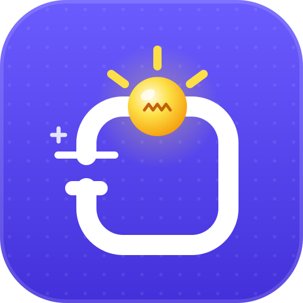

  

<h1 align="center">مختبر الدوائر</h1>

  <b>ابنِ الدائرة وشغّلها!</b> 
  <a href="https://circuitlab.app">circuitlab.app</a> · من منتجات <a href="https://sbc.om">SBC</a>

  <a href="README.md">English</a> · <a href="README.fa.md">فارسی</a> · <b>العربية</b>

مختبر الدوائر محاكٍ للدوائر الكهربائية للأطفال. اسحب القطع إلى اللوحة، وصِلها بالأسلاك، وشاهد الدائرة تنبض بالحياة: تضيء المصابيح، وتتوهّج الليدات، وتدور المحركات، وتطنّ الطنّانات، وتعرض الشاشات الصور، وكل ذلك بالأبعاد الثلاثية. لا شيء ينكسر أو يسخن فعلًا، لذا يستطيع الأطفال تجربة أي شيء، وأن يخطئوا ويفهموا السبب.

## ثلاث لغات، كل كلمة

بُني مختبر الدوائر من الأساس **بالعربية والفارسية والإنجليزية**، فيحصل الطفل في مسقط أو طهران أو لندن على التطبيق نفسه بلغته.

- **كل شيء باللغات الثلاث:** اللوحة، وجميع القطع الـ94 ودروسها، و118 مشروعًا جاهزًا، و15 مهمة، وصندوق العُدّة بأدواته الـ69 واختباره، وكل نصيحة وتحذير.
- **من اليمين إلى اليسار حقًا:** بالعربية والفارسية ينقلب التطبيق كله كالمرآة، من اللوحات والقوائم إلى المنزلقات وأسهم لوحة المفاتيح، وتبقى المعادلات مثل V = A × Ω مقروءة بشكل صحيح.
- **خط مصمَّم لكل كتابة،** وأرقام فارسية حيث يتوقعها الأطفال الناطقون بالفارسية.
- **بحث يفهمك:** الشكلان العربي والفارسي للحرف نفسه (ي / ی، ك / ک) يصلان إلى النتيجة نفسها.
- **ذكاء اصطناعي يتكلم لغتك:** تفهم لوحة الذكاء الاصطناعي الطلبات باللغات الثلاث، وتجيب بلغة التطبيق.
- **غيِّر اللغة متى شئت** بزر الكرة الأرضية، ويُحفظ اختيارك.

## ماذا يستطيع الأطفال أن يفعلوا

- **مصادر الطاقة:** بطاريات من 1.5 إلى 12 فولت، ولوح شمسي، ومزوّد طاقة مخبري، وبطارية ليمون (ثلاث ليمونات تضيء ليدًا أحمر إضاءة خافتة)، وبطارية زر، ودينامو يدوي، وبنك طاقة.
- **اللوحات:** أردوينو أونو ونانو وميغا، وESP32، وESP8266، وراسبيري باي بيكو، وmicro:bit، وراسبيري باي. يمكن لكل منفذ أن يكون مشغّلًا أو مطفأً أو وامضًا أو بالتناوب أو متدرّجًا أو تابعًا لحسّاس، وتعرض اللوحة الشيفرة الحقيقية لما اخترته.
- **لوحة الذكاء الاصطناعي:** لوحة تتحدث إليها. صِل بها الأضواء والمحركات والطنّانات، ثم اكتب ما يجب أن تفعله: «اجعل الضوء الأحمر يومض»، «أشعل المصباح عندما يحلّ الظلام».
- **المفاتيح والمقابض:** مفتاح، وزر ضغط، ومفتاح درج، ومفتاح دقيق، ومخفّت إضاءة، ومقبض (مقاوم متغيّر)، وعصا تحكم، ومُرحِّل.
- **القطع الإلكترونية:** مقاومة (مع درس قراءة الألوان)، ومكثّف، وثنائي (دايود)، ودايود زينر، وترانزستورات، وموسفت، ومقرن ضوئي، وفيوز، ومنظّم جهد.
- **الشرائح والمنطق:** بوابات NOT وAND وOR وXOR وNAND وNOR مع جدول صواب حيّ، وذاكرة (لاتش)، وعدّاد أضواء متلاحقة، ومقارن، ومومض 555، ومشغّل محرك.
- **الضوء والصوت والحركة:** مصباح، وليد، وليد RGB، ومحرك، ومحرك اهتزاز، وطنّان (صفير أو صفارة شرطة حقيقية)، ومكبّر صوت، وجرس كهربائي، ومغناطيس كهربائي، وملف لولبي، ومحرك سيرفو، وليزر، وليد تحت أحمر، وإشارة مرور، وشريط ليدات، ومروحة، ومضخة ماء بماء يتحرك فعلًا.
- **الحسّاسات:** الضوء، والحرارة، والميل، والمغناطيس، والمسافة، والحركة، والصوت، والدخان، والتربة، واللمس، واللهب، والمطر، ومستوى الماء، والرطوبة، والعوائق، والخط، والضغط، ونبض القلب، والطَّرق.
- **الشاشات:** شاشات أرقام، وشاشات نصية وملوّنة، ومصفوفات ليد، وجدران ليد بأي حجم، للافتات المتاجر ولتلفاز المدينة الذي يعرض صورك ومقاطعك.
- **أجهزة القياس:** ملتيميتر، ومجسّ منطقي، وفولتميتر، وأميتر، وراسم إشارة (أوسيلوسكوب).
- **أخطاء آمنة:** الجهد الزائد يحرق المصباح، والليد بلا مقاومة يحترق، والسلك الواصل مباشرة بين طرفي البطارية يسبّب دائرة قصر، والفيوز يحترق ليحمي بقية الدائرة.
- **118 مشروعًا جاهزًا** على اثني عشر رفًّا، من مصباح يدوي إلى إشارة مرور وحسّاس ركن ورادار وسيارة روبوت وبيت ذكي متكلّم، مع بحث وتصفية سهل / متوسط / صعب.
- **الدروس:** كل قطعة تشرح عملها بكلمات بسيطة للأطفال، إضافةً إلى درس «الفولت والأمبير والأوم» الذي يستخدم الأرقام الحيّة من اللوحة.
- **صندوق العُدّة:** 69 أداة حقيقية من الورشة، لكل منها رسم وطريقة استعمال ونصيحة أمان ومعلومة طريفة، إضافةً إلى اختبار «أيّ أداة؟» وقائمة عُدّة البداية.
- **المهام:** خمسة عشر تحديًا، من «اصنع مصباحًا يدويًا» إلى «اجعل ليدًا يومض بالأردوينو»، مع احتفال بالقصاصات الملوّنة عند إنجاز كل مهمة.

## تحدّث مع لوحة الذكاء الاصطناعي

تستخدم لوحة الذكاء الاصطناعي نموذجًا لغويًا يعمل على حاسوبك نفسه عبر [Ollama](https://ollama.com). بلا حساب وبلا سحابة: كلمات الطفل تبقى في البيت.

1. ثبّت Ollama من [ollama.com](https://ollama.com) وافتحه.
2. نزّل نموذجًا مرة واحدة، مثلًا `ollama pull gemma3:4b`.
3. في مختبر الدوائر، أضف لوحة ذكاء اصطناعي (أو افتح مثالًا من رف **الذكاء الاصطناعي**) واضغط **اسأل** على بطاقتها.

إذا نقص شيء، تعرض لوحة الذكاء الاصطناعي خطوات بسيطة لإصلاحه.

## في كل مكان

- **عبر الإنترنت** على [circuitlab.app](https://circuitlab.app)، على الحاسوب أو الجهاز اللوحي أو الهاتف.
- **ثبّته كتطبيق** من قائمة المتصفح («تثبيت» أو «إضافة إلى الشاشة الرئيسية»).
- **يعمل دون إنترنت** بعد الزيارة الأولى، وتُحفظ لوحتك تلقائيًا.
- **الوضع الفاتح والداكن:** في الوضع الداكن تصبح اللوحة غرفة مظلمة تتوهّج فيها الأضواء حقًا.

## من نحن

مختبر الدوائر من منتجات **SBC** · [sbc.om](https://sbc.om)

