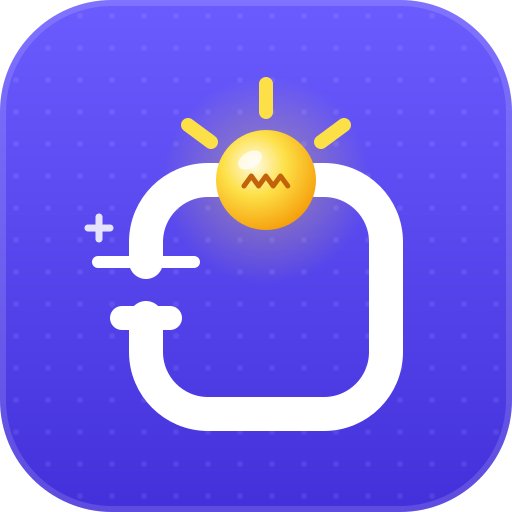

  

<h1 align="center">آزمایشگاه مدار</h1>

  <b>مدار بساز، روشنش کن!</b> 
  <a href="https://circuitlab.app">circuitlab.app</a> · محصولی از <a href="https://sbc.om">SBC</a>

  <a href="README.md">English</a> · <b>فارسی</b> · <a href="README.ar.md">العربية</a>

آزمایشگاه مدار یک شبیه‌ساز مدار برای بچه‌هاست. قطعه‌ها را روی میز بکش، با سیم به هم وصلشان کن و ببین مدار جان می‌گیرد: لامپ‌ها روشن می‌شوند، ال‌ای‌دی‌ها می‌درخشند، موتورها می‌چرخند، بازرها بوق می‌زنند و نمایشگرها تصویر نشان می‌دهند؛ همه سه‌بعدی. هیچ چیز واقعاً خراب یا داغ نمی‌شود، پس بچه‌ها می‌توانند هر چیزی را امتحان کنند، اشتباه کنند و بفهمند چرا.

## سه زبان، تک‌تک کلمه‌ها

آزمایشگاه مدار از پایه به **فارسی، عربی و انگلیسی** ساخته شده است؛ کودکی در تهران، مسقط یا لندن همان برنامه را به زبان خودش می‌بیند.

- **همه چیز به هر سه زبان:** میز کار، هر ۹۴ قطعه و درس‌هایشان، ۱۱۸ پروژهٔ نمونه، ۱۵ ماموریت، جعبه‌ابزار کارگاه با ۶۹ ابزار و مسابقه‌اش، و همهٔ نکته‌ها و هشدارها.
- **راست‌به‌چپ واقعی:** در فارسی و عربی کل برنامه آینه می‌شود، از پنل‌ها و منوها تا اسلایدرها و کلیدهای جهت‌نما، و فرمول‌هایی مثل V = A × Ω باز هم درست خوانده می‌شوند.
- **فونتی مخصوص هر خط،** و اعداد فارسی همان‌جا که بچه‌های فارسی‌زبان انتظارش را دارند.
- **جستجویی که حرفت را می‌فهمد:** شکل عربی و فارسی یک حرف (ي / ی، ك / ک) به همان نتیجه می‌رسند.
- **هوش مصنوعی‌ای که زبانت را بلد است:** برد هوش مصنوعی درخواست را به هر سه زبان می‌فهمد و به زبان برنامه جواب می‌دهد.
- **هر وقت خواستی زبان را عوض کن** با دکمهٔ کرهٔ زمین؛ انتخابت یادش می‌ماند.

## بچه‌ها چه کارهایی می‌توانند بکنند

- **منبع انرژی:** باتری از ۱٫۵ تا ۱۲ ولت، پنل خورشیدی، منبع تغذیه، باتری لیمویی (سه لیمو یک ال‌ای‌دی قرمز را کم‌نور روشن می‌کند)، باتری سکه‌ای، دینام دستی و پاوربانک.
- **بردها:** آردوینو اونو، نانو و مگا، ESP32، ESP8266، رزبری پای پیکو، میکروبیت و رزبری پای. هر پایه می‌تواند روشن، خاموش، چشمک‌زن، نوبتی، کم‌وزیادشونده یا دنبال‌کنندهٔ یک سنسور باشد، و برد کد واقعیِ همان انتخاب را نشان می‌دهد.
- **برد هوش مصنوعی:** بردی که با آن حرف می‌زنی. چراغ و موتور و بازر را به آن وصل کن و بنویس چه کار کنند: «چراغ قرمز را چشمک‌زن کن»، «وقتی هوا تاریک شد لامپ را روشن کن».
- **کلیدها و ولوم‌ها:** کلید، شستی، کلید راه‌پله، میکروسوییچ، دیمر، ولوم (پتانسیومتر)، جوی‌استیک و رله.
- **قطعات الکترونیکی:** مقاومت (با درس خواندن رنگ‌ها)، خازن، دیود، دیود زنر، ترانزیستورها، ماسفت، اپتوکوپلر، فیوز و رگولاتور ولتاژ.
- **تراشه‌ها و منطق:** گیت‌های NOT، AND، OR، XOR، NAND و NOR با جدول درستی زنده، حافظهٔ لچ، شمارندهٔ چراغ‌های دنبال‌هم، مقایسه‌گر، چشمک‌زن ۵۵۵ و درایور موتور.
- **نور، صدا و حرکت:** لامپ، ال‌ای‌دی، ال‌ای‌دی RGB، موتور، موتور ویبره، بازر (بیپ یا آژیر واقعی پلیس)، بلندگو، زنگ برقی، آهنربای الکتریکی، سلونوئید، سروو، لیزر، ال‌ای‌دی مادون قرمز، چراغ راهنمایی، نوار ال‌ای‌دی، فن و پمپ آب با آبی که واقعاً جریان دارد.
- **سنسورها:** نور، دما، شیب، آهنربا، فاصله، حرکت، صدا، دود، خاک، لمس، شعله، باران، سطح آب، رطوبت، مانع، خط، فشار، ضربان قلب و ضربه.
- **نمایشگرها:** نمایشگر عددی، صفحه‌های متنی و رنگی، ماتریس ال‌ای‌دی و دیوارهای ال‌ای‌دی در هر اندازه، برای تابلوی مغازه‌ها و تلویزیون شهری که عکس‌ها و فیلم‌های خودت را پخش می‌کند.
- **وسایل اندازه‌گیری:** مولتی‌متر، لاجیک‌پروب، ولت‌متر، آمپرمتر و اسیلوسکوپ.
- **اشتباه‌های بی‌خطر:** ولتاژ زیاد لامپ را می‌سوزاند، ال‌ای‌دی بدون مقاومت می‌سوزد، سیمی که دو سر باتری را مستقیم به هم وصل کند اتصال کوتاه درست می‌کند، و فیوز می‌سوزد تا بقیهٔ مدار سالم بماند.
- **۱۱۸ پروژهٔ نمونه** در دوازده قفسه، از چراغ‌قوه تا چراغ راهنمایی، سنسور پارک، رادار، ماشین رباتی و خانهٔ هوشمند سخنگو، با جستجو و فیلتر آسان / متوسط / سخت.
- **درس‌ها:** هر قطعه با زبان ساده توضیح می‌دهد چه کار می‌کند، به‌علاوهٔ درس «ولت، آمپر و اهم» که با عددهای زندهٔ روی میز کار می‌کند.
- **جعبه‌ابزار:** ۶۹ ابزار واقعی کارگاه، هر کدام با نقاشی، طرز استفاده، نکتهٔ ایمنی و یک دانستنی جالب، به‌علاوهٔ مسابقهٔ «کدام ابزار؟» و چک‌لیست ابزارهای شروع.
- **ماموریت‌ها:** پانزده چالش، از «یک چراغ‌قوه بساز» تا «با آردوینو یک ال‌ای‌دی را چشمک‌زن کن»، با جشن کاغذرنگی برای هر ماموریتی که تمام می‌شود.

## حرف زدن با برد هوش مصنوعی

برد هوش مصنوعی از یک مدل زبانی استفاده می‌کند که با [Ollama](https://ollama.com) روی کامپیوتر خودتان اجرا می‌شود. بدون حساب کاربری و بدون فضای ابری: حرف‌های کودک در خانه می‌ماند.

1. Ollama را از [ollama.com](https://ollama.com) نصب و باز کنید.
2. یک بار یک مدل دانلود کنید، مثلاً `ollama pull gemma3:4b`.
3. در آزمایشگاه مدار یک برد هوش مصنوعی اضافه کنید (یا یک نمونه از قفسهٔ **هوش مصنوعی** را باز کنید) و روی کارتش **بپرس** را بزنید.

اگر چیزی کم باشد، پنل هوش مصنوعی قدم‌های ساده‌ای برای درست کردنش نشان می‌دهد.

## همه‌جا همراه شما

- **آنلاین** در [circuitlab.app](https://circuitlab.app)، روی کامپیوتر، تبلت یا گوشی.
- **نصب مثل یک برنامه** از منوی مرورگر (گزینهٔ «نصب» یا «افزودن به صفحهٔ اصلی»).
- **کار بدون اینترنت** بعد از اولین بازدید؛ میز کار هم خودکار ذخیره می‌شود.
- **حالت روشن و تیره:** در حالت تیره میز کار مثل اتاقی تاریک می‌شود که چراغ‌ها در آن واقعاً می‌درخشند.

## دربارهٔ ما

آزمایشگاه مدار محصولی از **SBC** است · [sbc.om](https://sbc.om)

