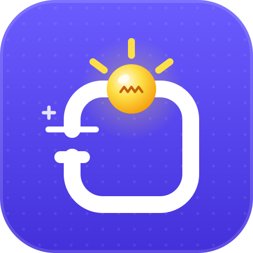

  

<h1 align="center">Circuit Lab</h1>

  <b>Build it. Light it up!</b> 
  <a href="https://circuitlab.app">circuitlab.app</a> · A product of <a href="https://sbc.om">SBC</a>

  <b>English</b> · <a href="README.fa.md">فارسی</a> · <a href="README.ar.md">العربية</a>

Circuit Lab is a circuit simulator for kids. Drag parts onto the board, wire them together and watch the circuit come alive: lamps glow, LEDs light up, motors spin, buzzers beep and screens show pictures, all in 3D. Nothing can really break or get hot, so children can try anything, make mistakes and learn why.

## Three languages, every word

Circuit Lab is built in **English, Persian and Arabic** from the ground up, so a child in Tehran, Muscat or London gets the same app in their own words.

- **Everything in all three:** the board, all 94 parts and their lessons, 118 example projects, 15 missions, the 69-tool workshop Toolbox and its quiz, and every tip and warning.
- **Real right-to-left:** in Persian and Arabic the whole app mirrors, from the panels and menus to the sliders and arrow keys, while formulas like V = A × Ω still read correctly.
- **A font made for each script,** and Persian digits where Persian children expect them.
- **Search that understands you:** Arabic and Persian spellings of the same letter (ي / ی, ك / ک) find the same thing.
- **An AI that speaks your language:** the AI board understands requests in any of the three and answers in the app's language.
- **Switch any time** with the globe button. The choice is remembered.

## What kids can do

- **Power:** batteries from 1.5 to 12 V, a solar panel, a bench power supply, a lemon battery (three lemons just light a red LED), a coin cell, a hand dynamo and a USB power bank.
- **Boards:** Arduino Uno, Nano and Mega, ESP32, ESP8266, Raspberry Pi Pico, micro:bit and Raspberry Pi. Each pin can be on, off, blinking, taking turns, fading or following a sensor, and the board shows the real code for what you chose.
- **AI board:** a board you talk to. Wire lights, motors and buzzers to it, then type what they should do: "make the red light blink", "turn the lamp on when it gets dark".
- **Switches and knobs:** switch, push button, stair switch, micro switch, dimmer, knob (potentiometer), joystick and relay.
- **Electronic parts:** resistor (with a colour-code lesson), capacitor, diode, Zener diode, transistors, MOSFET, optocoupler, fuse and voltage regulator.
- **Chips and logic:** NOT, AND, OR, XOR, NAND and NOR gates with a live truth table, a memory latch, a light-chaser counter, a comparator, a 555 blinker and a motor driver.
- **Light, sound and motion:** lamp, LED, RGB LED, motor, vibration motor, buzzer (a beep or a real police siren), speaker, electric bell, electromagnet, solenoid, servo, laser, infrared LED, traffic light, LED bar graph, fan and a water pump with moving water.
- **Sensors:** light, temperature, tilt, magnet, distance, motion, sound, smoke, soil, touch, flame, rain, water level, humidity, obstacle, line, pressure, heartbeat and knock.
- **Screens:** number displays, text and colour screens, LED matrices and LED walls of any size for shop signs and a city TV that plays your own photos and videos.
- **Meters:** a multimeter, a logic probe, a voltmeter, an ammeter and an oscilloscope.
- **Things that go wrong, safely:** too many volts burn a lamp, an LED without a resistor burns out, a wire straight across a battery makes a short circuit, and a fuse blows to protect the rest.
- **118 example projects** on twelve shelves, from a flashlight to a traffic light, a parking sensor, a radar, a robot car and a talking smart home, with search and an easy / medium / hard filter.
- **Lessons:** every part explains what it does in kid-friendly words, plus a "volts, amps and ohms" lesson that uses the live numbers from the board.
- **Toolbox:** 69 real workshop tools, each with a drawing, how to use it, how to stay safe and a fun fact, plus a "Which tool?" quiz and a starter-kit checklist.
- **Missions:** fifteen challenges, from "build a flashlight" to "blink an LED with the Arduino", with confetti when one is done.

## Talk to the AI board

The AI board uses a language model that runs on your own computer with [Ollama](https://ollama.com). No account and no cloud: the child's words stay at home.

1. Install Ollama from [ollama.com](https://ollama.com) and open it.
2. Download a model once, for example `ollama pull gemma3:4b`.
3. In Circuit Lab, add an AI board (or open an example from the **Talk to AI** shelf) and press **Ask** on its card.

If something is missing, the AI panel shows simple steps to fix it.

## Use it anywhere

- **Online** at [circuitlab.app](https://circuitlab.app), on a computer, tablet or phone.
- **Install it** like an app from the browser's menu ("Install" or "Add to Home Screen").
- **Works offline** after the first visit, and the board is saved automatically.
- **Light and dark mode:** in dark mode the board becomes a dark room where lights really shine.

## About

Circuit Lab is a product of **SBC** · [sbc.om](https://sbc.om)
